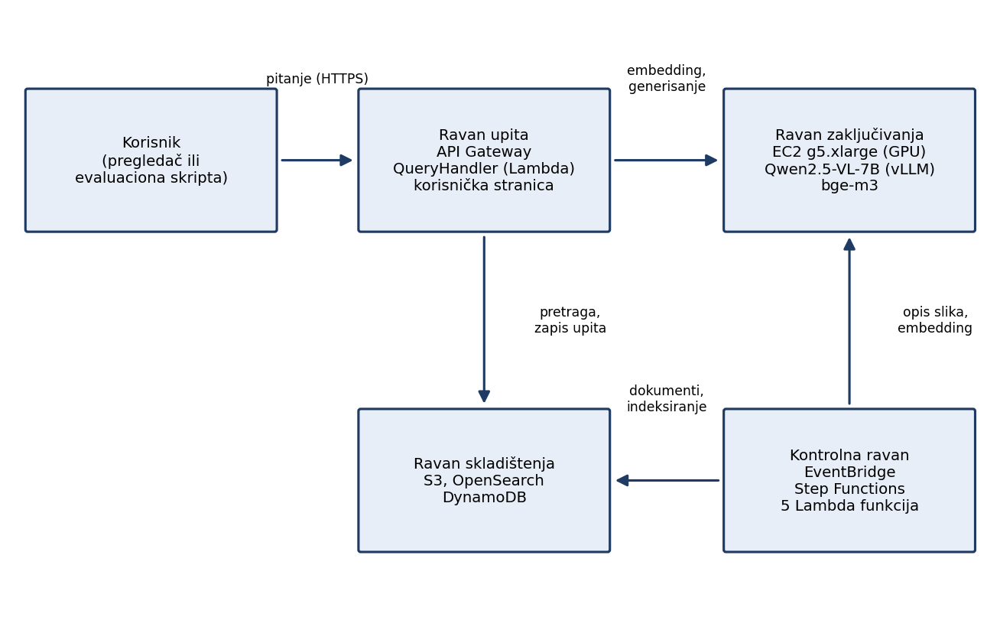

# rag-system-infra

Praktični deo diplomskog rada **„Projektovanje i implementacija privatno hostovanog
RAG sistema za pitanja i odgovore nad tehničkom dokumentacijom“** (Elektronski
fakultet u Nišu, Katedra za računarstvo).

Sistem odgovara na pitanja nad internom tehničkom dokumentacijom, uključujući
tabele, dijagrame i grafikone, tako da i dokumenti i modeli ostaju na
infrastrukturi koju korisnik kontroliše. Infrastruktura je opisana kao kod (AWS
CDK, TypeScript), a obrada je u Python-u.

## Šta se meri

Slike se pri obradi dokumenata pretvaraju u tekstualni opis (vizuelno-jezički
model), pa sistem pretražuje isključivo tekstualni vektorski prostor. Eksperiment
poredi dve varijante generatora, uz **istu pretragu i isti model**:

| Varijanta | Šta generator dobija za deo dokumenta poreklom od slike |
|---|---|
| **A** | samo tekstualni opis slike |
| **B** | opis **i originalnu sliku** |

Pitanje je koliko informacija se gubi kada se slika svede na opis, i koliko
originalna slika to nadoknađuje. Tekst prompta je u obe varijante isti, što je
zaključano testom.

## Arhitektura



| Stack | Sadržaj | Životni ciklus |
|---|---|---|
| `RagNetworkStack` | VPC (javne podmreže u 3 zone, bez NAT-a), security grupe, gateway endpointi za S3 i DynamoDB | trajno |
| `RagStorageStack` | S3 bucket (`raw/`, `images/`, `manifests/`), DynamoDB `ingestion-log` i `query-log` | trajno, zaštićeno od brisanja |
| `RagModelServingStack` | grupa za automatsko skaliranje 0–1 (`g5.xlarge`, rezervno `g5.2xlarge`, NVIDIA A10G 24 GB): vLLM sa Qwen2.5-VL-7B-Instruct-AWQ (port 8000) i bge-m3 (port 8001) | trajno; instanca se pali po potrebi |
| `RagSearchStack` | OpenSearch 2.19, indeks sa hibridnom šemom (BM25 + kNN + retke težine), interface endpointi za EC2 i SSM | podiže se i ruši po potrebi |
| `RagIngestionStack` | EventBridge → Step Functions (DistributedMap) → 5 Lambda funkcija | trajno |
| `RagQueryStack` | API Gateway `POST /query` (API ključ), Lambda `QueryHandler`, statična korisnička stranica | trajno |
| `RagObservabilityStack` | predviđen za nadzorne table; trenutno prazan | — |

Indeks je izveden podatak (može se ponovo napraviti iz `raw/`), pa je vektorska
baza u zasebnom stack-u koji se ruši tokom pauza, dok dokumenti i `query-log`
ostaju. Skupi delovi (GPU, OpenSearch) se plaćaju samo dok rade; ostatak sistema u
mirovanju košta praktično ništa.

## Struktura repozitorijuma

| Putanja | Sadržaj |
|---|---|
| `bin/`, `lib/` | CDK aplikacija i stack-ovi |
| `lambda/` | Python kod Lambda funkcija: ekstrakcija i podela na delove, opis slika, vektorizacija, indeksiranje, upiti (`query_handler/`) |
| `ec2-userdata/vllm-bootstrap.sh` | automatsko podizanje oba servera modela, sa fiksiranim verzijama paketa |
| `ui/` | statična korisnička stranica (poređenje A i B jedno pored drugog) |
| `corpus/demo/` | generator sintetičkog korpusa (22 dokumenta fiktivne firme) i 106 pitanja sa očekivanim odgovorima |
| `evaluation/` | evaluacija: postavljanje pitanja, metrike pretrage, RAGAS, McNemar-ov test — vidi [evaluation/README.md](evaluation/README.md) |
| `test/python/` | testovi (stdlib `unittest`, bez instalacije) |

Korpus je **sintetički** namerno: model ne sme moći da odgovor zna iz treniranja,
inače merenje vernosti izvorima gubi smisao.

## Pokretanje

Preduslovi: Node 22 (`nvm use`), Docker (pakovanje Lambda funkcija), AWS profil.

```bash
export AWS_PROFILE=lazar-private
nvm use
npm install
python3 -m unittest discover -s test/python      # testovi, bez AWS-a
```

Prvi deploy, redom (`-e` = samo navedeni stack):

```bash
npx cdk deploy RagNetworkStack RagStorageStack RagModelServingStack -e
npx cdk deploy RagSearchStack RagIngestionStack RagQueryStack -e
```

Rad sa sistemom:

```bash
# GPU: tacne komande su u izlazima StartCommand / StopCommand stack-a RagModelServingStack
aws autoscaling set-desired-capacity --auto-scaling-group-name <asg> --desired-capacity 1
#   instanca je spremna kad dobije tag vllm-status=ready (~11-13 min od nule)

# rucni pristup GPU-u (dijagnostika): samo preko SSM-a, nijedan port nije otvoren ka internetu
aws ssm start-session --target <instance-id>                      # ljuska
aws ssm start-session --target <instance-id> \
  --document-name AWS-StartPortForwardingSession \
  --parameters '{"portNumber":["8000"],"localPortNumber":["8000"]}' # tunel: localhost:8000 -> vLLM

# dokumenti: postavljanje u raw/ automatski pokrece obradu
aws s3 cp corpus/demo/dokumenti/ s3://<bucket>/raw/ --recursive

# pitanja: korisnicka stranica (izlaz UiUrl), API kljuc preko izlaza ApiKeyCommand

# gasenje skupih delova
aws autoscaling set-desired-capacity --auto-scaling-group-name <asg> --desired-capacity 0
npx cdk destroy RagSearchStack -e     # traje 15-45 min
```

## Prvi rezultati (preliminarni)

Merenje `eval-2026-10-02`: 106 pitanja × 2 varijante; tačnost i vernost ocenjuje
spoljni model (Claude) preko biblioteke RAGAS, a razlika se testira uparenim
McNemar-ovim testom (tačan oblik). Ručna ocena još nije urađena.

| | A | B | p |
|---|---|---|---|
| tačnost, pitanja čiji je odgovor samo na slici (56) | 30 | 37 | 0,065 |
| vernost izvorima, ista pitanja | 33 | 47 | 0,001 |
| tačnost, tekstualna pitanja (50) | 42 | 41 | 1,00 |

## Napomene

- Radne beleške o odlukama i stanju projekta: [CLAUDE.md](CLAUDE.md).
- Broj AWS naloga, adrese resursa i API ključevi nisu u repozitorijumu; čitaju se
  iz izlaza stack-ova.
